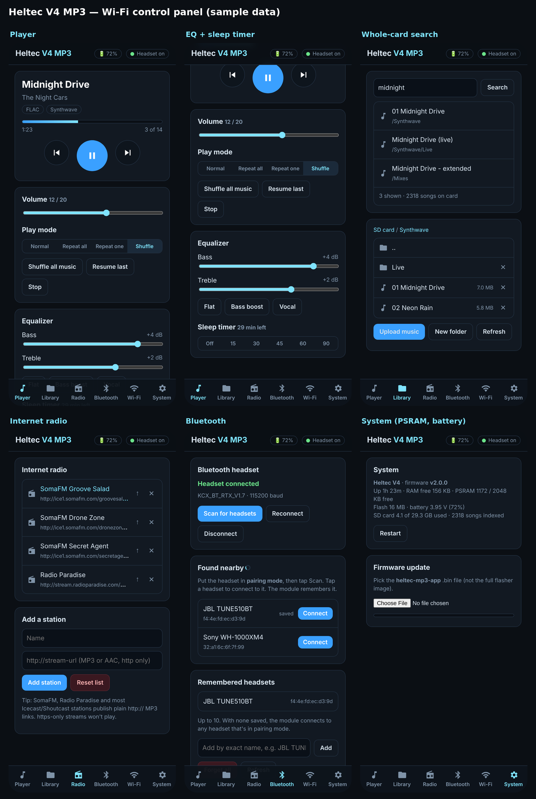
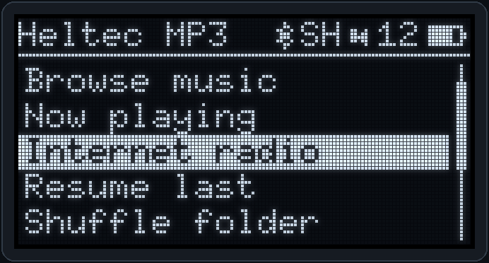
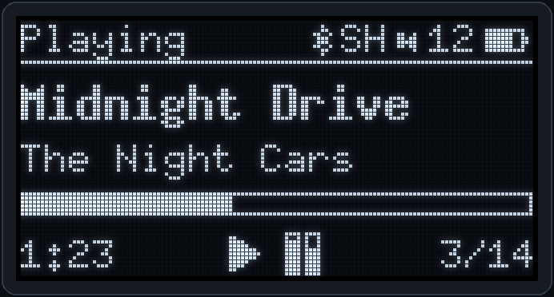
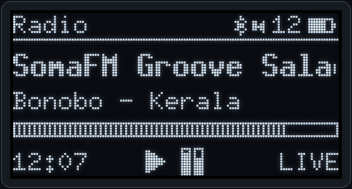
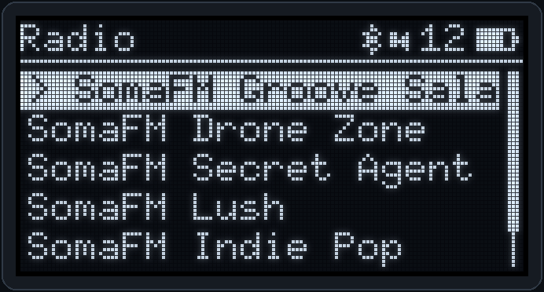
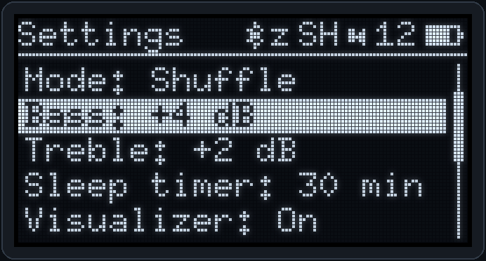
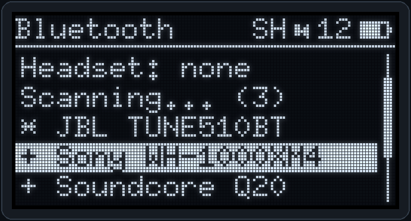
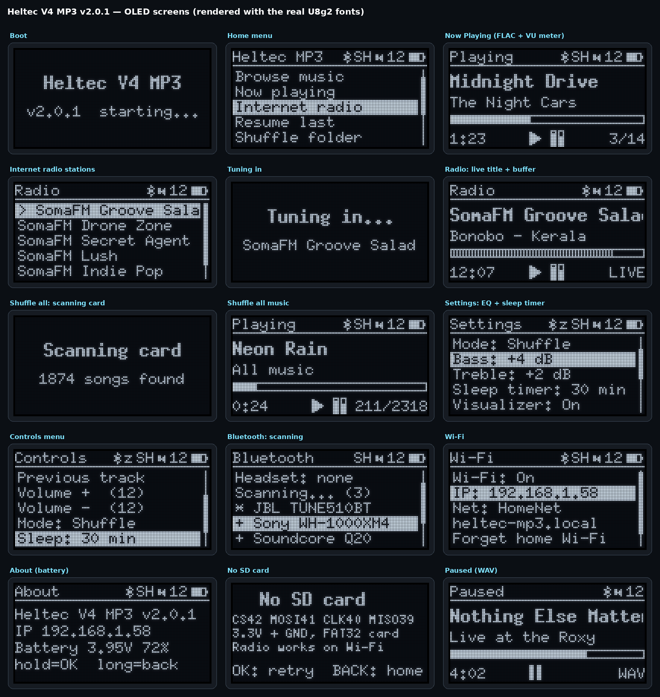
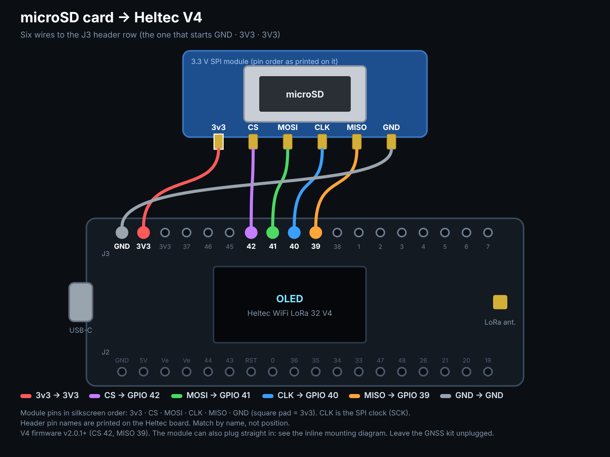
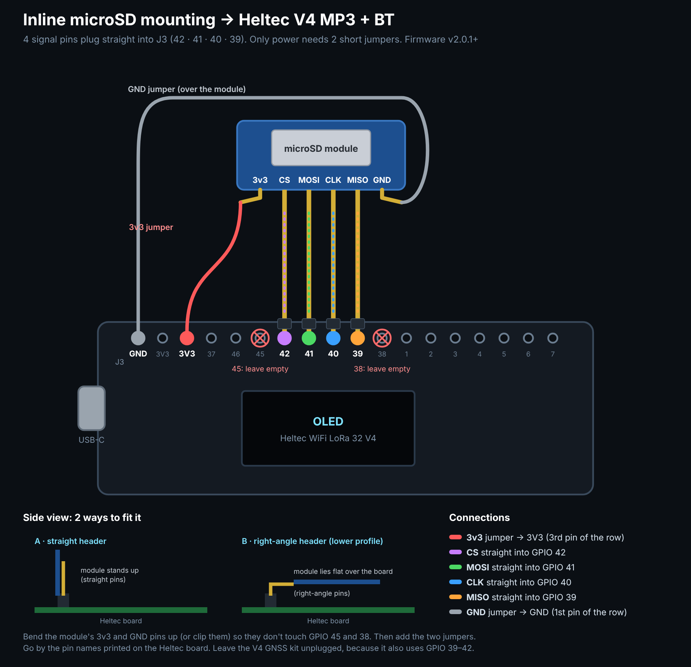

# Heltec V4 MP3 + BT

<p align="center">
  <a href="https://hardwaremack-prog.github.io/Heltec-V4-MP3-BT/"></a>
</p>

**One-click install:** open **[hardwaremack-prog.github.io/Heltec-V4-MP3-BT](https://hardwaremack-prog.github.io/Heltec-V4-MP3-BT/)** in Chrome or Edge, plug in your Heltec **V3 or V4**, and click *Connect & Flash*. It detects which board you have and installs the right firmware.

The **expanded** pocket music player for the **Heltec WiFi LoRa 32 V4** (ESP32-S3R2, 2 MB PSRAM, 16 MB flash).
It's the big brother of [Heltec-V3-MP3-BT](https://github.com/hardwaremack-prog/Heltec-V3-MP3-BT) and uses the V4's extra memory and flash.



## OLED screens

The player's 0.96" screen, rendered with the same U8g2 fonts the firmware uses:

<table>
<tr><td align="center"><br><sub>Home menu</sub></td><td align="center"><br><sub>Now Playing (FLAC + VU)</sub></td><td align="center"><br><sub>Internet radio, live title</sub></td></tr>
<tr><td align="center"><br><sub>Radio stations</sub></td><td align="center"><br><sub>EQ + sleep timer</sub></td><td align="center"><br><sub>Bluetooth scan</sub></td></tr>
</table>

<details><summary>All screens</summary>



</details>

## What's new vs. the V3 version

| | V3 version | **V4 version** |
|---|---|---|
| Formats | MP3 | **MP3, AAC (.aac), FLAC, WAV** |
| Internet radio | – | **http:// MP3/AAC streams, live song titles, station list on the web page** |
| Library | 256 items per folder | **2000 per folder, "Shuffle all music" (5000 songs), whole-card search** |
| Read-ahead buffer | 4 KB | **64 KB (files) / 128 KB (radio) in PSRAM** |
| Sound | volume | **+ bass / treble EQ (±6 dB) with presets** |
| Extras | – | **Sleep timer with fade-out, VU meter, battery gauge** |
| Flash layout | 3.2 MB app | **2 × 4 MB app (OTA) + 7.9 MB LittleFS** |
| Power | – | LoRa amplifier kept switched off |

Everything from the V3 version is still here: OLED menus, PRG-only or 4-button control, Bluetooth headsets through a KCX_BT_EMITTER (scan / connect / forget), the Wi-Fi control panel with MP3 upload, wireless updates and the one-file browser flasher.

> **Why a Bluetooth module?** The ESP32-S3 only has Bluetooth Low Energy. Headsets need Classic Bluetooth (A2DP), so a KCX_BT_EMITTER (a few dollars) handles the headset, and the player controls it with serial "AT" commands.

## Flashing

1. Easiest: use the **[web flasher](https://hardwaremack-prog.github.io/Heltec-V4-MP3-BT/)**. Or open **`flasher/index.html`** in Chrome or Edge on a computer (it works offline).
2. Plug in the V4 and click **Connect & Flash**. Pick the **USB JTAG/serial debug unit** port; the V4 uses the chip's own USB.
3. If no port shows up: hold **PRG**, tap **RST**, release PRG, and try again. If the port disappears after flashing, unplug and replug the board.

You can also flash with esptool:

```
esptool.py --chip esp32s3 write_flash 0x0 releases/heltec-v4-mp3-v2.0.1.bin
```

For wireless updates (System tab), use `releases/heltec-v4-mp3-app-v2.0.1.bin`.

> Built for the standard **V4 (ESP32-S3R2)**. The V4-R8 variant moves Vext, LED and ADC_Ctrl to other pins.

## Wiring (V4)

The V4 uses some GPIOs that were free on the V3:

- **GPIO 2, 5, 7, 46:** LoRa power amplifier
- **GPIO 19, 20:** USB
- **GPIO 26:** PSRAM

Leave those alone. The SD card shares GPIO 39–42 with the GNSS connector, so **don't plug in the GNSS kit**.

### microSD card



**Easier: plug it straight in.** From firmware **v2.0.1** the SD pins are CS 42 · MOSI 41 · CLK 40 · MISO 39. Those are four neighbouring J3 pins in the same order as the module's CS · MOSI · CLK · MISO, so the module can plug straight into the header. Bend up (or clip) its 3v3 and GND pins so they skip GPIO 45 and 38, then add two short jumpers to the GND and 3V3 pins at the start of the row.



| microSD (3.3 V SPI) | V4 |
|---|---|
| VCC / GND | 3V3 / GND |
| CLK (SCK) | GPIO 40 |
| MOSI | GPIO 41 |
| MISO | GPIO 39 |
| CS | GPIO 42 |

| PCM5102A DAC | V4 |
|---|---|
| VIN / GND | 3V3 / GND |
| BCK | GPIO 48 |
| LCK | GPIO 47 |
| DIN | GPIO 33 |
| SCK | GND |

| KCX_BT_EMITTER (V1.7 recommended) | Connect to |
|---|---|
| +5V / PGND | V4 5V / GND |
| AUDIO_L / AUDIO_R / AGND | DAC LOUT / ROUT / AGND |
| RX | level shifter ← GPIO 43 (header TX) |
| TX | level shifter → GPIO 44 (header RX) |
| LINK | level shifter → GPIO 38 |

Use a 4-channel BSS138 level shifter (LV = 3V3, HV = 5V). The `5V` pin only has power on USB, so add a 5 V boost board for battery or solar use.

**Buttons (optional, each wired GPIO → button → GND):** UP GPIO 4, DOWN GPIO 6, OK GPIO 3, BACK GPIO 34. These differ from the V3 version.

**Battery:** plug a 1-cell LiPo into the V4's battery connector. The gauge uses the board's own sensing (GPIO 1 + 37), so it needs no wiring.

## Controls

| PRG button | Menus | Now Playing |
|---|---|---|
| Tap | Down | Next track / station |
| Double-tap | Up | Play / Pause |
| Hold ~1 s, release | Select | Controls (volume, mode, **sleep**, stop) |
| Hold 1.5 s+ | Back | Home |

| Add-on button | Menus | Now Playing |
|---|---|---|
| UP / DOWN | Move (hold = fast scroll) | Volume (hold = next / previous) |
| OK | Select | Play / Pause (hold = Controls) |
| BACK | Back | File list or station list |

**OLED Home menu:** Browse music · Now playing · Internet radio · Resume last · Shuffle folder · Shuffle all music · Bluetooth · Wi-Fi · Settings · About

## Internet radio

- **Needs home Wi-Fi.** Join the player to your network first; hotspot mode has no internet.
- **Default stations:** SomaFM (Groove Salad, Drone Zone, Secret Agent, Lush, Indie Pop) and Radio Paradise. The list is kept in the board's flash (`/stations.txt`).
- **Your own stations:** add, reorder and delete them in the web page's **Radio** tab.
- **http:// only.** Plain MP3 or AAC streams work; https-only streams won't play.
- **Now Playing** shows the station, the live song title, a **LIVE** tag and how full the buffer is. If the stream drops, the player reconnects automatically (up to 3 tries).

## Wi-Fi

- **First boot:** the player makes a hotspot named **Heltec-MP3-XXXX**, password `heltecmp3`. Join it and go to `192.168.4.1`.
- **Home network:** add it in the Wi-Fi tab. After that, use `http://heltec-mp3.local` or the IP shown on the OLED.

## Building from source

- **Arduino core:** ESP32 **3.3.x**.
- **Board:** *Heltec WiFi LoRa 32(V4)* with **PSRAM: QSPI PSRAM**, **Flash Size: 16MB**, **USB CDC On Boot: Enabled**.
- **Partitions:** the sketch's own `partitions.csv` is used automatically. It has two 4 MB app slots and 7.9 MB of LittleFS. If the IDE complains about sketch size, pick *Partition Scheme: Custom* or raise `upload.maximum_size` to 4194304.
- **Libraries:** ESP8266Audio 2.4+ and U8g2.

arduino-cli example:

```
arduino-cli compile -b "esp32:esp32:heltec_wifi_lora_32_V4:PSRAM=enabled,FlashSize=16M,CDCOnBoot=cdc,USBMode=hwcdc" \
  --build-property upload.maximum_size=4194304 firmware/HeltecV4MP3
```

Rebuild the flasher with:

```
python3 flasher/build_flasher.py <merged.bin> 2.0.1 <esptool-js bundle.js>
```

`tools/oled_sim_v4.c` renders the OLED screens on a PC (see the V3 repo for the command).

## Web flasher (GitHub Pages)

`docs/` is the online flasher served at the link above. It holds both firmwares (`docs/firmware/`), so the same page flashes a V3 or a V4. When you build a new firmware, copy the trimmed merged `.bin` into `docs/firmware/` and update the version in `docs/index.html`.

## Changelog

- **v2.0.1:** microSD pins changed to the **inline** layout (CS 42, MOSI 41, CLK 40, MISO 39) so the module plugs straight into the J3 header. If your board is wired the v2.0.0 way (CS 39, MISO 42), swap those two wires.
- **v2.0.0:** first V4 release.

## Credits

- KCX_BT_EMITTER AT commands: [Mark-MDO47/BluetoothAudioTransmitter_KCX_BT_EMITTER](https://github.com/Mark-MDO47/BluetoothAudioTransmitter_KCX_BT_EMITTER)
- V4 pin details: Heltec docs and the [Meshtastic heltec_v4 variant](https://github.com/meshtastic/firmware/tree/develop/variants/esp32s3/heltec_v4)
- Audio: [ESP8266Audio](https://github.com/earlephilhower/ESP8266Audio) · Display: [U8g2](https://github.com/olikraus/u8g2) · Flashing: [esptool-js](https://github.com/espressif/esptool-js)
